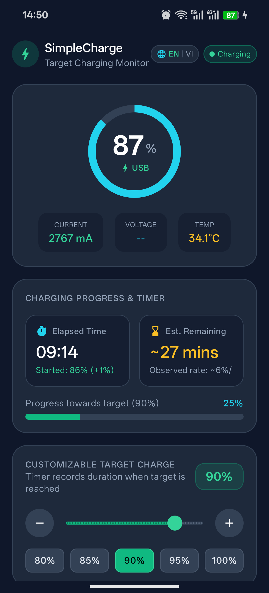
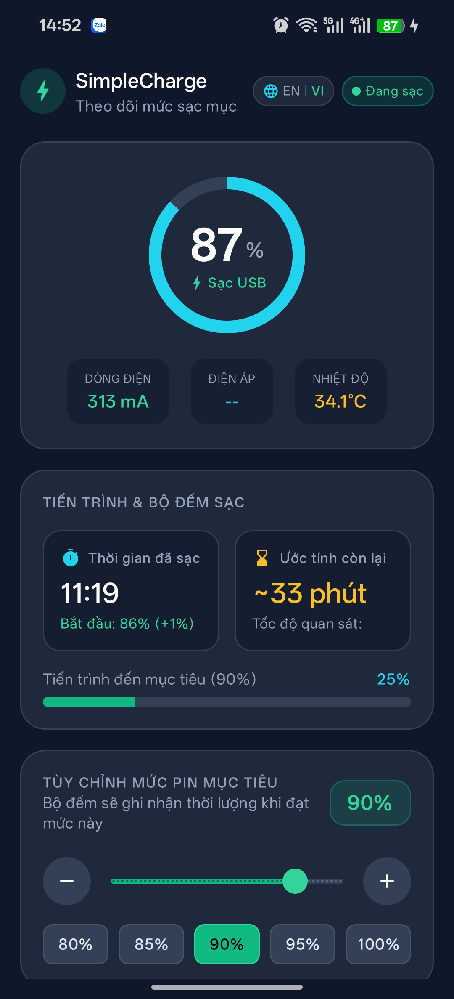
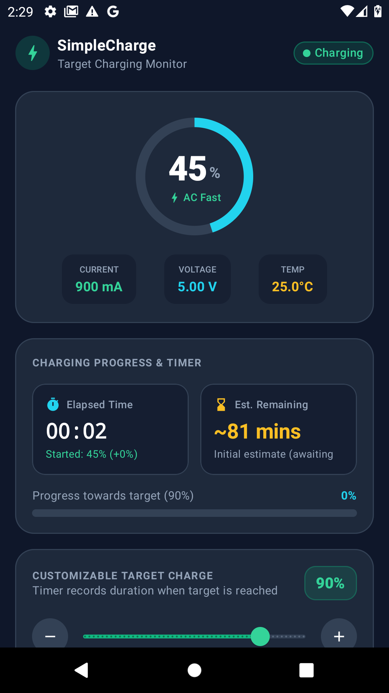
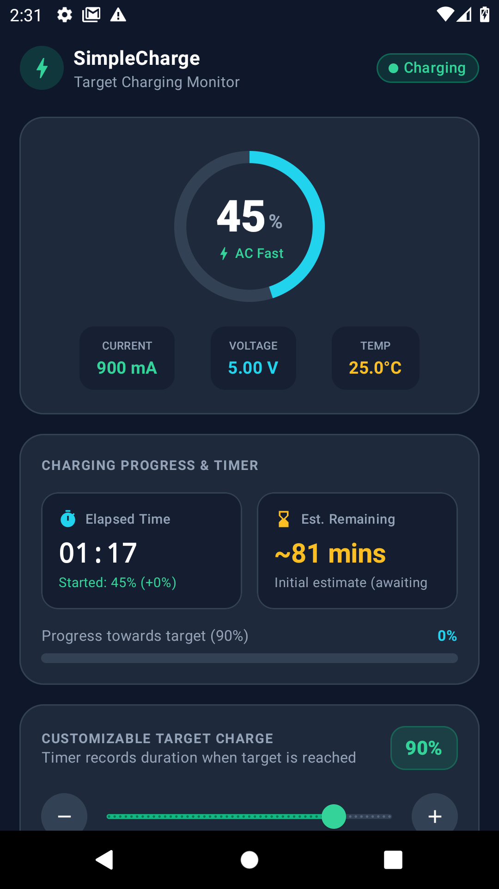
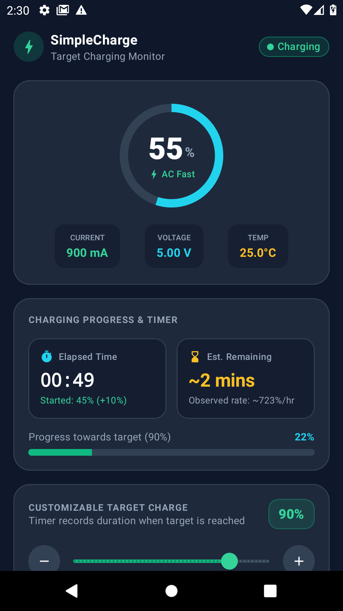
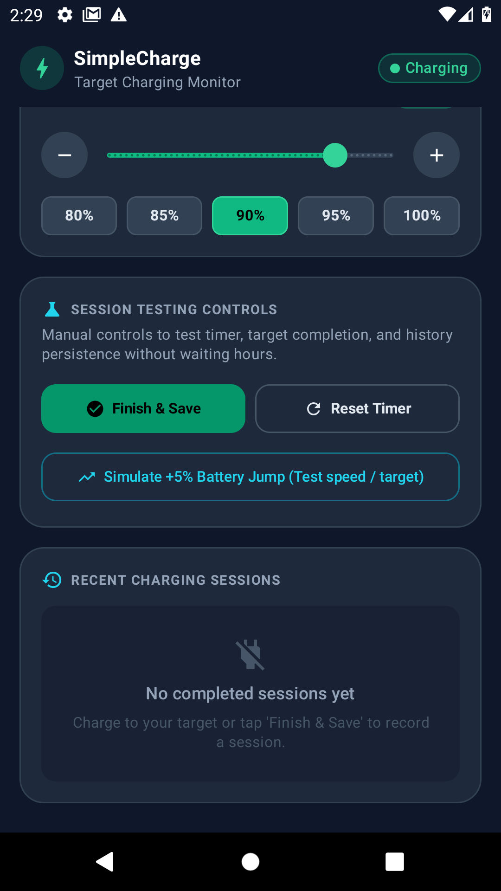
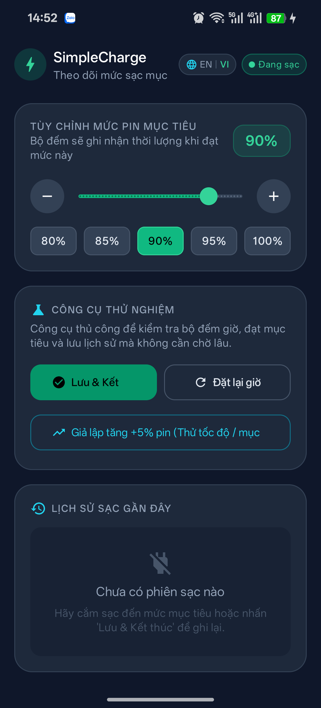
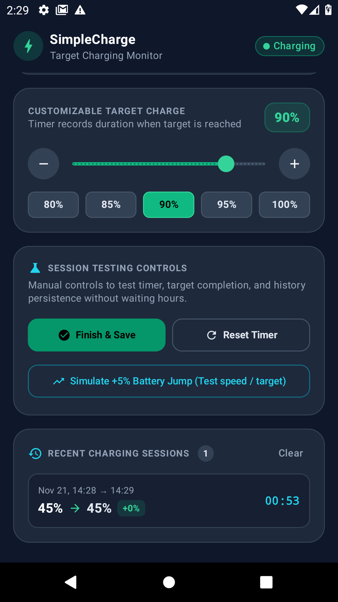

# ⚡ SimpleCharge — Android Battery Target Monitor

<p align="center">
  
</p>

**SimpleCharge** is a clean, minimal Android app built with **Kotlin + Jetpack Compose** that helps you charge your phone smarter — set a custom target %, track elapsed time, and get real-time estimates for when you'll hit your goal.

**SimpleCharge** là ứng dụng Android tối giản giúp bạn sạc pin thông minh hơn — đặt mức pin mục tiêu, theo dõi thời gian sạc và nhận ước tính thời gian hoàn thành theo tốc độ sạc thực tế.

---

## ✨ Features / Tính năng

---

### 1. 🔋 Live Battery Status / Trạng thái pin thực tế

**English:** A large animated circular gauge shows the current battery level at a glance. The ring color changes dynamically:
- 🔵 **Cyan** — actively charging
- 🟢 **Green** — target reached (or above)
- 🔴 **Red** — critically low (≤ 20%)

Real-time metrics are displayed beneath the gauge:
- ⚡ **Charging current** (mA)
- 🔌 **Voltage** (V)
- 🌡️ **Temperature** (°C)
- **Plug type** — USB / AC Fast Charge / Wireless

**Tiếng Việt:** Vòng tròn pin lớn với animation hiển thị mức pin hiện tại. Màu sắc thay đổi theo trạng thái:
- 🔵 **Xanh cyan** — đang sạc
- 🟢 **Xanh lá** — đã đạt mục tiêu
- 🔴 **Đỏ** — pin yếu (≤ 20%)

Thông số thực tế bên dưới: dòng sạc (mA), điện áp (V), nhiệt độ (°C), loại sạc (USB / AC nhanh / Không dây).

<p align="center">
  
  &nbsp;&nbsp;
  
</p>

---

### 2. ⏱️ Charging Progress & Timer / Tiến trình & Bộ đếm sạc

**English:** When charging starts (or if the phone is already charging on launch), the app automatically records:
- **Start timestamp** and **start battery %**
- An **elapsed timer** (HH:mm:ss) that counts up in real time
- A **progress bar** from start % → target %

Session state **persists across app restarts** — if you close the app mid-charge and reopen it, the timer resumes from where it left off.

**Tiếng Việt:** Khi cắm sạc (hoặc nếu điện thoại đang sạc lúc mở app), ứng dụng tự động ghi lại:
- Thời điểm bắt đầu và mức pin lúc đầu
- Bộ đếm thời gian sạc (giờ:phút:giây) chạy liên tục
- Thanh tiến trình từ % bắt đầu → % mục tiêu

Trạng thái phiên sạc **tồn tại qua các lần khởi động lại app** — đóng app rồi mở lại, bộ đếm vẫn tiếp tục.

<p align="center">
  
  &nbsp;&nbsp;
  
</p>

---

### 3. 🕐 Estimated Time Remaining / Ước tính thời gian còn lại

**English:** SimpleCharge calculates how long it will take to reach your target %:

- **Initial estimate** — uses a standard 1%/min rate when charging first starts (shows `~X min`)
- **Observed rate** — after **≥ 30 seconds** and **≥ 1% gained**, switches to your actual observed charging speed (shows `~X min` with real data)
- Displays the current rate in `%/hr` for reference

**Tiếng Việt:** Ứng dụng tính toán thời gian còn lại để đạt mục tiêu:

- **Ước tính ban đầu** — dùng tốc độ chuẩn 1%/phút khi mới bắt đầu sạc
- **Tốc độ thực tế** — sau **≥ 30 giây** và **≥ 1% tăng**, chuyển sang tốc độ sạc thực đo được
- Hiển thị tốc độ hiện tại theo đơn vị `%/giờ`

<p align="center">
  
  &nbsp;&nbsp;
  
</p>

---

### 4. 🎯 Customizable Target Charge % / Mức pin mục tiêu tùy chỉnh

**English:** Set your own charging target anywhere from **50% to 100%** (default: **90%**):
- **Slider** for smooth adjustment
- **± 1% stepper buttons** for fine-tuning
- **Quick preset chips**: 80 / 85 / 90 / 95 / 100%
- Target is **persisted locally** — survives app restarts

The app automatically stops the charging timer and records the session when battery level reaches or exceeds the target.

**Tiếng Việt:** Đặt mức pin mục tiêu từ **50% đến 100%** (mặc định: **90%**):
- **Thanh trượt** để điều chỉnh nhanh
- **Nút ± 1%** để tinh chỉnh
- **Preset nhanh**: 80 / 85 / 90 / 95 / 100%
- Mục tiêu được **lưu cục bộ** và giữ nguyên sau khi khởi động lại

App tự động dừng bộ đếm và lưu phiên sạc khi mức pin đạt hoặc vượt mục tiêu.

<p align="center">
  
  &nbsp;&nbsp;
  
</p>

---

### 5. 🌐 Language Switcher / Chuyển ngôn ngữ

**English:** A compact **`🌐 EN | VI`** pill in the top header bar lets you switch between **English** and **Vietnamese** with a single tap. The active language is highlighted in **emerald green**. Your selection is **persisted across app restarts** via SharedPreferences.

All UI strings are fully localized — labels, statuses, units, placeholders, and button text.

**Tiếng Việt:** Nút **`🌐 EN | VI`** nhỏ gọn trên thanh tiêu đề cho phép chuyển giữa **Tiếng Anh** và **Tiếng Việt** chỉ với một lần nhấn. Ngôn ngữ đang chọn được tô màu **xanh lá emerald**. Lựa chọn được **lưu qua SharedPreferences** và giữ nguyên khi khởi động lại.

Toàn bộ chuỗi UI được dịch đầy đủ — nhãn, trạng thái, đơn vị, placeholder và tên nút.

<p align="center">
  
  &nbsp;&nbsp;
  
</p>

| English | Tiếng Việt |
|---|---|
| Charging | Đang sạc |
| Unplugged | Đã rút sạc |
| Target reached! | Đã đạt mục tiêu! |
| Elapsed Time | Thời gian đã sạc |
| Est. Remaining | Ước tính còn lại |
| Customizable Target Charge | Mức pin mục tiêu |
| Recent Charging Sessions | Lịch sử sạc gần đây |
| Finish & Save | Lưu phiên sạc |
| Reset Timer | Đặt lại giờ |

---

### 6. 📋 Charging Session History / Lịch sử phiên sạc

**English:** Every completed charging session is saved and displayed in a **Recent Charging Sessions** list:
- **Start/end time** (date + clock)
- **Start % → End %** battery range
- **Total duration** (HH:mm:ss)
- **Charging rate** (%/min)

Up to **30 sessions** are stored locally; the list shows the **5 most recent** at a glance. All data persists in SharedPreferences.

**Tiếng Việt:** Mỗi phiên sạc hoàn thành được lưu và hiển thị trong danh sách **Lịch sử sạc gần đây**:
- Thời gian bắt đầu/kết thúc (ngày + giờ)
- Mức pin từ % đầu → % cuối
- Tổng thời gian sạc (HH:mm:ss)
- Tốc độ sạc (%/phút)

Lưu tối đa **30 phiên** cục bộ; hiển thị **5 phiên gần nhất**. Toàn bộ dữ liệu lưu trong SharedPreferences.

<p align="center">
  
</p>

---

### 7. 🧪 Session Testing Controls / Công cụ thử nghiệm

**English:** A **Testing Tools** section lets you manually control session state without waiting for the battery to change — useful for demos and debugging:
- **Finish & Save** — immediately ends the current session and saves it to history
- **Reset Timer** — clears the current session and restarts the timer from zero
- **Simulate +5%** — adds 5% to the simulated battery level to test the speed estimate and target detection

**Tiếng Việt:** Phần **Công cụ thử nghiệm** cho phép điều khiển thủ công trạng thái phiên sạc — hữu ích để demo và debug:
- **Lưu phiên sạc** — kết thúc ngay phiên hiện tại và lưu vào lịch sử
- **Đặt lại giờ** — xóa phiên hiện tại và khởi động lại bộ đếm từ đầu
- **Giả lập +5%** — tăng 5% pin mô phỏng để kiểm tra tính năng ước tính và phát hiện mục tiêu

<p align="center">
  
  &nbsp;&nbsp;
  
</p>

---

## 📸 Screenshots / Ảnh chụp màn hình

| EN — Charging | EN — Observed Speed | EN — History |
|:---:|:---:|:---:|
|  |  |  |

| VI — Top | VI — Bottom | EN — After Restart |
|:---:|:---:|:---:|
|  |  |  |

---

## 🛠️ Build & Install / Hướng dẫn build & cài đặt

### Prerequisites / Yêu cầu
- Android Studio (Hedgehog or later) or JDK 17+
- Android SDK (API 26+)
- ADB installed and in PATH
- USB debugging enabled on your device

### Build / Build APK

```powershell
# Windows
.\gradlew.bat assembleDebug

# macOS / Linux
./gradlew assembleDebug
```

Output APK: `app/build/outputs/apk/debug/app-debug.apk`

### Install via ADB / Cài đặt qua ADB

```bash
# Check connected devices / Kiểm tra thiết bị kết nối
adb devices

# Standard install
adb install -r app/build/outputs/apk/debug/app-debug.apk

# For devices that reject adb install (e.g. OPPO/ColorOS)
# Dành cho thiết bị từ chối cài trực tiếp (ví dụ OPPO/ColorOS)
adb push app/build/outputs/apk/debug/app-debug.apk /data/local/tmp/app-debug.apk
adb shell pm install -r -d -g /data/local/tmp/app-debug.apk

# Launch / Khởi động
adb shell monkey -p com.example.simplecharge -c android.intent.category.LAUNCHER 1

# Screenshot / Chụp màn hình
adb shell screencap -p /sdcard/screenshot.png
adb pull /sdcard/screenshot.png
```

---

## 🏗️ Technical Details / Chi tiết kỹ thuật

| Item | Detail |
|---|---|
| Language | Kotlin |
| UI Framework | Jetpack Compose + Material 3 |
| Min SDK | API 26 (Android 8.0 Oreo) |
| Target SDK | API 35 |
| Architecture | Single-Activity, Composable UI |
| State Management | `remember` + `mutableStateOf` + SharedPreferences |
| Persistence | SharedPreferences (target %, language, session state, history) |
| Battery Events | `BroadcastReceiver` — `ACTION_BATTERY_CHANGED`, `ACTION_POWER_CONNECTED`, `ACTION_POWER_DISCONNECTED` |
| Localization | Pure Kotlin `AppStrings` data class (no Android string resources) |
| Build System | Gradle 8.8 + Android Gradle Plugin 8.5.1 |

### Permissions / Quyền truy cập

```xml
<!-- No special permissions needed — battery info is available without permissions -->
<!-- Không cần quyền đặc biệt — thông tin pin có sẵn không cần permission -->
```

### Project Structure / Cấu trúc dự án

```
app/src/main/java/com/example/simplecharge/
├── MainActivity.kt                   # Entry point, language state
├── data/
│   ├── ChargingSession.kt            # Session data model
│   └── SessionManager.kt            # SharedPreferences persistence
├── receiver/
│   └── BatteryReceiver.kt           # BroadcastReceiver for battery events
└── ui/
    ├── SimpleChargeApp.kt            # Main Composable UI
    ├── Localization.kt               # EN/VI string definitions
    └── theme/
        ├── Color.kt
        └── Theme.kt
```

---

## 📄 License

MIT License — feel free to use, modify, and distribute.

---

<p align="center">Built with ❤️ using Kotlin & Jetpack Compose</p>
